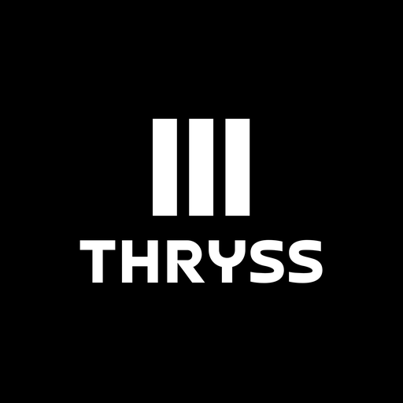

# Jose Sanchis

Full-stack developer in Valencia, Spain, moving my focus to frontend and UX.
7 years building web and mobile products with React, React Native and Laravel, mostly in healthcare.

[Leer en español](README.es.md)

## Thryss

A mobile app for lists, checklists and polls that I designed, built and released on my own.

The idea behind it is that people should be able to join without installing anything. Anyone with a link or a QR code can vote in a poll or tick a checklist from a public page, and only the owner edits the list.

I sketched every screen before writing code, then built the Expo app, the Laravel API and the deployment pipeline myself.

[Google Play](https://play.google.com/store/apps/details?id=es.thryss.app) · [App Store](LINK) · [thryss.es](https://thryss.es)

## At work

Team lead for up to 4 developers at a small product company. We decide the technology and how each feature is built, and I own production deployments. Most of that work is private client code, so it does not appear here.

## Stack

React · React Native · Expo · TypeScript · Laravel · MySQL · Redis · Docker · GitHub Actions

## Also on GitHub

[Snake-ML](https://github.com/josesanchis16/snake-ml), a small experiment to understand how machine learning works under the hood.

## Contact

[LinkedIn](https://linkedin.com/in/josesanchis16) · sanchisbeldajose@gmail.com
